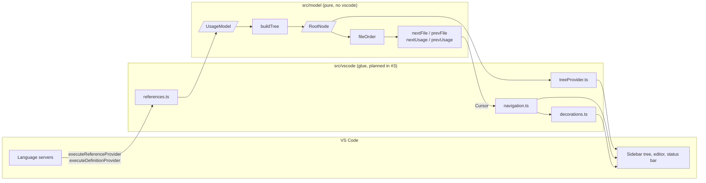

# Callsite architecture

These docs track how Callsite is put together. Update them in the same PR as any change to the model's shape or to how the tree is built.

| Doc | Covers |
| --- | --- |
| [Data model](data-model.md) | Every type in `src/model/types/`, how they relate, and where each field comes from and goes to |
| [buildTree](build-tree.md) | How `buildTree` turns a `UsageModel` into the sidebar tree, step by step, with a worked example |

## Layers

Callsite is split into a pure model and thin VS Code glue. The model never imports `vscode`; ESLint fails the build if anything under `src/model` tries to (`import`, `import type`, `require()`, `import()` or `import x = require()`). That keeps the logic testable with Vitest, without starting VS Code.



## Data flow

1. **Collect** (glue): the glue asks the language servers for references and the definition, then resolves each location's workspace root, path segments and line text with VS Code's own APIs. The result is one `UsageModel`.
2. **Build** (model): `buildTree(model)` returns a `RootNode`. See [buildTree](build-tree.md).
3. **Render** (glue): the tree provider maps each node to a `TreeItem`.
4. **Navigate** (model + glue): `fileOrder(root)` flattens the tree into the files in display order. The stepping functions take a `Cursor` and return a new one, and the glue opens, reveals and decorates whatever the cursor points at.

Every later view (v2 excerpts, v3 impact map) also starts from the `UsageModel`, so the model is the one contract between VS Code and the views.

## Source layout

```
src/
  extension.ts       activate / deactivate
  model/
    buildTree.ts     UsageModel -> RootNode
    order.ts         display order, next/prev file and usage, NO_CURSOR
    utils.ts         compareUsages, compareNames, joinPath, hasFile
    tree/
      draft.ts       newDraft, insertFile: the mutable tree buildTree fills in
      finish.ts      finishFolder, finishChildren: Draft -> finished nodes
    types/           one type per file, re-exported from types/index.ts
  vscode/            glue (planned in #3)
test/
  unit/              Vitest: buildTree.test.ts, order.test.ts, factories.ts, helpers.ts
  integration/       @vscode/test-cli, runs inside VS Code
```

## Navigation in brief

`order.ts` works on the flat `FileNode[]` from `fileOrder`, so it never walks the tree itself.

- `nextFile` / `prevFile` take a file index and wrap at the ends.
- `nextUsage` / `prevUsage` take a `Cursor`, move within the file, roll over to the neighbouring file, and wrap at the ends.
- All four return `undefined` when there are no files.
- A cursor can outlive the results it points into (a refresh can leave fewer files). A file index out of range counts as "nothing selected", and usage indexes are clamped to the file's usages.
- `NO_CURSOR` (`{ fileIndex: -1, usageIndex: -1 }`) is frozen and shared. Cursors are never changed in place.
