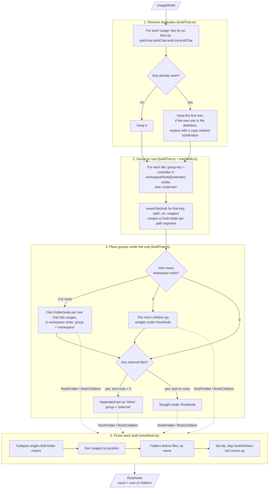

# buildTree

`buildTree(model: UsageModel): RootNode` in `src/model/buildTree.ts` turns the results for one symbol into the tree the sidebar shows. It's a pure function: same input, same tree, no `vscode` and no I/O.

The work is split across three files:

| File | Functions | Job |
| --- | --- | --- |
| `buildTree.ts` | `buildTree` | Remove duplicates, group files by workspace root, place the groups under the root |
| `tree/draft.ts` | `newDraft`, `insertFile` | Build a mutable `Draft` folder tree from path segments |
| `tree/finish.ts` | `finishFolder`, `finishChildren` | Turn a `Draft` into finished nodes: collapse chains, sort, count, set ids |

## Pipeline



## 1. Remove duplicates

Language servers sometimes report the same location twice, for example the declaration from both the references and the definition provider. `buildTree` keeps one usage per file and range:

- Usages are grouped in a `Map<uri, Map<rangeKey, Usage>>`, where `rangeKey` is `startLine:startChar:endLine:endChar`.
- The first usage seen for a key wins.
- If a later duplicate has `isDefinition: true` and the kept one doesn't, the kept one is replaced by a copy with `isDefinition: true`, so the definition flag is never lost.

Files keep the order they were first seen in. That order doesn't matter, because step 4 sorts everything.

## 2. Group by root

Each file goes into one `Draft` per group:

- The group is the file's `rootIndex`, if `workspaceRoots[rootIndex]` exists.
- Otherwise it is `<external>`: the file is outside every workspace folder (or its `rootIndex` is out of range).
- The group and path are read from the file's first usage. The glue gives every usage of one URI the same `rootIndex` and `path`.

`insertFile(group, path, uri, usages)` walks `path` minus its last segment, creating a child `Draft` for each folder it doesn't have yet, then stores the file under its URI in the last folder's `files` map. Keying files by URI means two files with the same path (say a local and a remote copy) stay separate.

## 3. Place groups under the root

| Workspace roots | Root's children |
| --- | --- |
| 0 (no folder open) | External files straight under the root. There's nothing to be "other" than |
| 1 | That root's folders and files straight under the root, then **Other** if any files are external |
| 2 or more | One folder node per root that has usages, in workspace order (not sorted), each with `group: 'workspace'`, then **Other** |

Roots with no usages don't appear. **Other** is always last, with `group: 'external'`.

Workspace and **Other** nodes are built with `finishFolder` directly, so they are never merged with a single child. Only the folders inside them collapse.

## 4. Finish each draft

`finishChildren(draft, groupKey, path, definitionUri)` turns one `Draft` level into nodes, and `finishFolder` wraps that in a `FolderNode`. They call each other recursively down the tree.

**Collapse chains.** For each subfolder, while the folder has no files and exactly one subfolder, it merges with that subfolder: the names join with `/` (`components` + `billing` → `components/billing`) and the path grows to match. The loop stops at a folder that has a file or two or more subfolders, so a folder never merges into its only file.

**Sort.**

- Usages: by start line, then start character (`compareUsages`).
- Folders: by name (`compareNames`).
- Files: by name, then by URI as a tiebreak.
- `compareNames` uses `Intl.Collator` with `numeric: true` and `sensitivity: 'base'`, so case is ignored and `file2` comes before `file10`. Names equal under those rules fall back to code-unit order, so the result is the same on every run.
- Folders come before files.

**Ids.**

- Folders: `folder:<groupKey>:<path>`, where `groupKey` is the root's URI or `<external>` and `path` is the full path within the group. A collapsed folder's id uses its deepest path, so the id stays the same if the chain collapses differently later.
- Files: `file:<uri>`.

**Flags and counts.**

- A file has `hasDefinition` when its URI is `model.definition.uri` or any of its usages has `isDefinition`.
- A file's `count` is its number of usages. A folder's `count` is the sum of its children's, and the root's is the sum of its top-level children's.

## Worked example

One workspace root, `app` (`file:///ws/app`). The language server reports six locations, one of them twice:

| `path` | Line | Note |
| --- | --- | --- |
| `src/components/billing/Invoice.tsx` | 3 |  |
| `src/components/billing/Invoice.tsx` | 10 |  |
| `src/components/billing/Total.tsx` | 5 | definition |
| `src/utils/format.ts` | 2 |  |
| `src/utils/format.ts` | 2 | same range again |
| `test/invoice.test.ts` | 7 |  |

**Step 1** drops the second `format.ts:2`, leaving 5 usages.

**Step 2** builds one draft for root 0:

```
(root 0)
├── src/
│   ├── components/
│   │   └── billing/
│   │       ├── Invoice.tsx  (2)
│   │       └── Total.tsx    (1)
│   └── utils/
│       └── format.ts        (1)
└── test/
    └── invoice.test.ts      (1)
```

**Step 3**: there is one root, so its children go straight under the root node, and there are no external files.

**Step 4**:

- `src` has two subfolders, so it stays as is.
- `components` has no files and one subfolder, so it merges with `billing`.
- `utils` has a file, so it stays.

```
Total — 5 usages                        root, count 5
├── src  (4)                            folder:file:///ws/app:src
│   ├── components/billing  (3)         folder:file:///ws/app:src/components/billing
│   │   ├── Invoice.tsx  (2)            file:file:///ws/app/src/components/billing/Invoice.tsx
│   │   └── Total.tsx  (1)  ★ def       hasDefinition: true
│   └── utils  (1)
│       └── format.ts  (1)
└── test  (1)
    └── invoice.test.ts  (1)
```

`fileOrder` on this tree returns `Invoice.tsx, Total.tsx, format.ts, invoice.test.ts`. Stepping with `nextFile` from the last one wraps back to `Invoice.tsx`.

### The same results in a multi-root workspace

Add a second root, `lib`, with no usages, and one usage in `/usr/lib/node_modules/x/index.d.ts` (outside both roots):

```
Total — 6 usages
├── app  (5)       group: 'workspace'   (the tree above, one level down)
└── Other  (1)     group: 'external'
    └── usr/lib/node_modules/x  (1)     chain collapsed inside Other
        └── index.d.ts  (1)
```

`lib` has no usages, so it isn't shown.

## Where it's tested

`test/unit/buildTree.test.ts` covers each rule above: counts and rollups, an empty result, duplicates and the definition merge, URI keying, chain collapsing (stopping at a folder with both files and subfolders, never merging into a file, ids from the full path), sort order, both ways a file gets `hasDefinition`, multi-root (order, skipped roots, no collapsing of a workspace node), **Other**, an out-of-range `rootIndex`, and the no-workspace case. Inputs come from the factories in `test/unit/factories.ts`, and `test/unit/helpers.ts` reduces the output to a compact shape for assertions.
