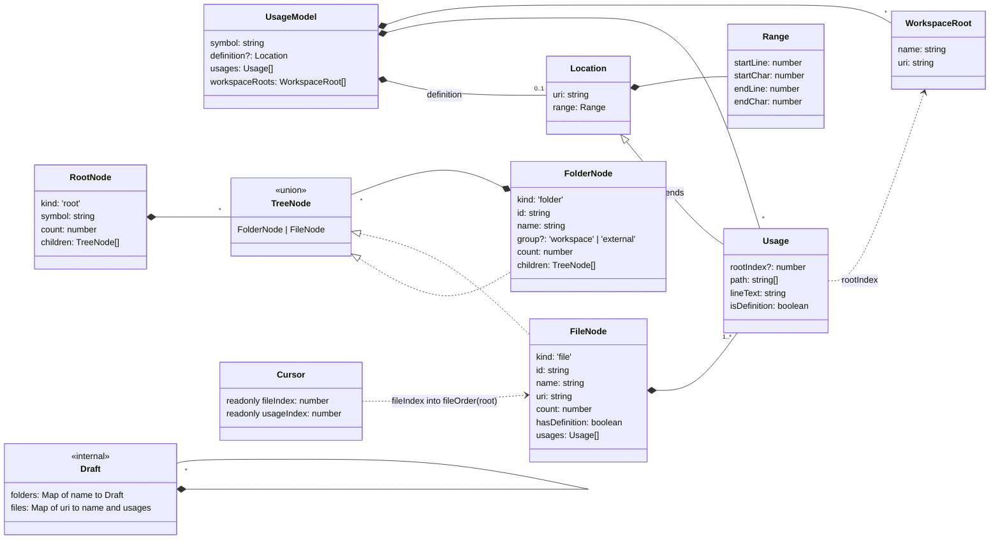

# Data model

All types live in `src/model/types/`, one per file, and are imported from `@/model/types`. They are plain objects: URIs are strings (`vscode.Uri.toString()`), ranges are four numbers, and nothing holds a `vscode` class.

There are two halves:

- **Input**: `UsageModel` and what it contains. The glue builds it from the language server results.
- **Output**: `RootNode` and the tree below it. `buildTree` builds it, and the sidebar renders it.

`Cursor` points into the output, and `Draft` exists only while `buildTree` runs.

## Type map

`Usage` objects pass through `buildTree` unchanged: the `FileNode.usages` arrays hold the same objects as `UsageModel.usages`. The only exception is a duplicate merged into a definition, which is a copy with `isDefinition: true` (see [buildTree](build-tree.md#1-remove-duplicates)).

## Input types

### `UsageModel` (`types/usageModel.ts`)

All results for one symbol: the input to every view.

| Field | Type | Meaning |
| --- | --- | --- |
| `symbol` | `string` | Name shown on the root node |
| `definition` | `Location?` | Where the symbol is defined, if the language server says |
| `usages` | `Usage[]` | Every reference, in any order. Duplicates are allowed |
| `workspaceRoots` | `WorkspaceRoot[]` | The open workspace folders, in workspace order. Empty when no folder is open |

### `WorkspaceRoot` (`types/workspaceRoot.ts`)

| Field | Type | Meaning |
| --- | --- | --- |
| `name` | `string` | Workspace folder name; the label of its node in a multi-root workspace |
| `uri` | `string` | Folder URI; used in folder node ids |

### `Location` (`types/location.ts`) and `Range` (`types/range.ts`)

A `Location` is a `uri` plus a `Range`. A `Range` is zero-based like `vscode.Range`: `startLine`, `startChar`, `endLine`, `endChar`.

### `Usage` (`types/usage.ts`)

One reference. It extends `Location` with what the views need to show it.

| Field | Type | Meaning |
| --- | --- | --- |
| `uri`, `range` | from `Location` | Where the reference is |
| `rootIndex` | `number?` | Index into `workspaceRoots` of the folder holding the file. `undefined` when the file is outside every root |
| `path` | `string[]` | Decoded path segments with the file name last. Relative to the root, or the whole `Uri.path` when outside every root. No query or fragment |
| `lineText` | `string` | Full text of the line the usage starts on |
| `isDefinition` | `boolean` | Whether this location is the definition |

**Design note:** the model does not work out roots or relative paths from URI strings. An early version did, and it broke on Windows drive-letter casing, URIs with queries or fragments, and same-path files outside the workspace. The glue fills in `rootIndex` and `path` using VS Code's own URI handling, and the model trusts them.

## Output types

### `RootNode` (`types/rootNode.ts`)

The top of the sidebar tree: `symbol`, total `count` and `children`. There is exactly one per `buildTree` call.

### `FolderNode` (`types/folderNode.ts`)

| Field | Type | Meaning |
| --- | --- | --- |
| `id` | `string` | `folder:<groupKey>:<path>`. Unique, and stable across rebuilds of the same results |
| `name` | `string` | Label. A collapsed chain is joined with `/`, e.g. `components/billing` |
| `group` | `'workspace' \| 'external'?` | `'workspace'`: a workspace folder in a multi-root workspace. `'external'`: the **Other** node. Unset for ordinary folders |
| `count` | `number` | Sum of the children's counts |
| `children` | `TreeNode[]` | Folders first, then files |

`groupKey` is the workspace root's URI, or `<external>` for files outside every root. `path` is the full path within that group, so `src/components/billing` keeps the same id whether or not it is collapsed into one node.

### `FileNode` (`types/fileNode.ts`)

| Field | Type | Meaning |
| --- | --- | --- |
| `id` | `string` | `file:<uri>` |
| `name` | `string` | The last path segment (falls back to the URI if `path` is empty) |
| `uri` | `string` | The file. Files are keyed by URI, so two files with the same path stay separate |
| `count` | `number` | Number of usages after duplicates are removed |
| `hasDefinition` | `boolean` | `uri === definition.uri`, or any usage has `isDefinition` |
| `usages` | `Usage[]` | Sorted by start line, then start character. Never empty |

### `TreeNode` (`types/treeNode.ts`)

`FolderNode | FileNode`, told apart by `kind`.

## Navigation and internal types

### `Cursor` (`types/cursor.ts`)

`{ fileIndex, usageIndex }`, both `readonly`. `fileIndex` indexes `fileOrder(root)` and `usageIndex` indexes that file's `usages`. `-1` means nothing is selected (`NO_CURSOR`).

### `Draft` (`types/draft.ts`)

The mutable folder `buildTree` fills in before finishing it into nodes: `folders` maps segment names to child drafts, and `files` maps URIs to `{ name, usages }`. Nothing outside `buildTree` and `src/model/tree/` sees it.

## Field mapping: VS Code → model → UI

This table records how each field is filled (in `src/vscode/references.ts`) and shown (in `src/vscode/treeItems.ts`), so the model and glue stay in step. Rows marked #4 or #5 are planned.

| Model field | Filled from (glue) | Shown as (UI) |
| --- | --- | --- |
| `UsageModel.symbol` | `document.getWordRangeAtPosition` at the cursor | Root label: `symbol — N usages` (`rootLabel`) |
| `UsageModel.definition` | First result of `vscode.executeDefinitionProvider`; for a `LocationLink`, its `targetSelectionRange` (the name) | Definition file icon and `· definition` (via `FileNode.hasDefinition`) |
| `UsageModel.workspaceRoots` | `vscode.workspace.workspaceFolders` (`name`, `uri.toString()`) | Workspace nodes in a multi-root workspace |
| `Usage.uri`, `Usage.range` | `vscode.executeReferenceProvider` results | Usage line click opens the file with the range selected; editor decorations and scrollbar marks (#4) |
| `Usage.rootIndex` | `vscode.workspace.getWorkspaceFolder(uri)?.index` | Which group the file lands in |
| `Usage.path` | `pathSegments(uri.path, folder?.uri.path)`: the root's segment count is dropped, so path casing doesn't matter | Folder hierarchy |
| `Usage.lineText` | `readLines` (`src/vscode/lineText.ts`): the open document's text if there is one, otherwise `workspace.fs.readFile` decoded as UTF-8, 32 files at a time, split with `splitLines`. Files aren't opened as documents. `''` if the file can't be read | Usage lines: `L42: text`, trimmed, with the usage highlighted (`usageLabel`) |
| `Usage.isDefinition` | Same URI and start position (`sameStart`) as any definition provider result, not only the first | Definition file icon |
| `FolderNode.count`, `FileNode.count` | computed by `buildTree` | Node `description` |
| `FolderNode.group` | computed by `buildTree` | Icon: `root-folder` for a workspace, `folder-library` for **Other**, the folder icon otherwise |
| `FolderNode.id`, `FileNode.id` | computed by `buildTree` | `TreeItem.id`, which keeps expansion state across refreshes |
| `Cursor` | computed by `order.ts` | Status bar: `File 2 of 7 · Usage 3/5` (#5) |

### `UsageLabel` (`types/usageLabel.ts`)

What `usageLabel(usage)` returns, shaped like `vscode.TreeItemLabel`: `label` is `L<line>: <trimmed text>`, and `highlights` holds one `[start, end)` span over the usage in that label, or nothing when the usage spans several lines.
